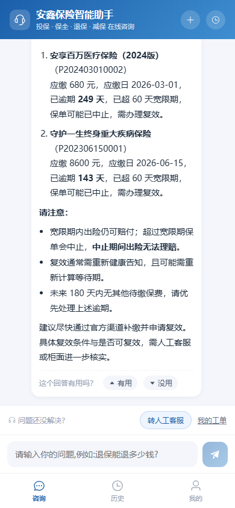
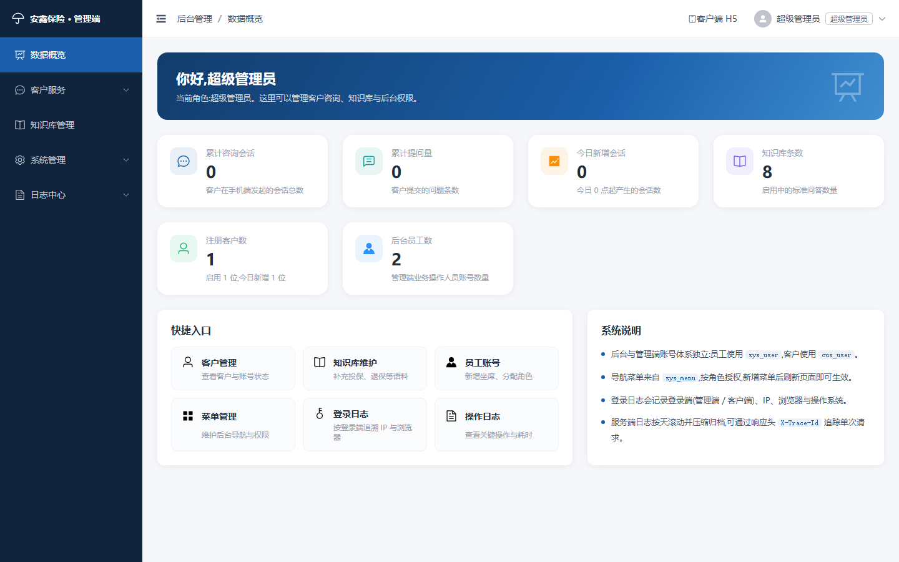
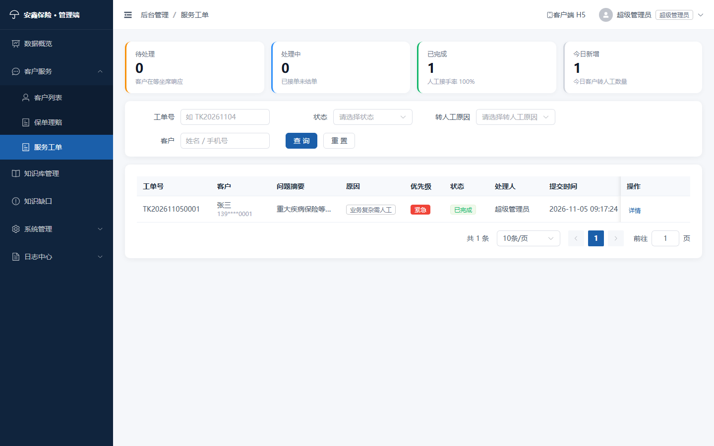
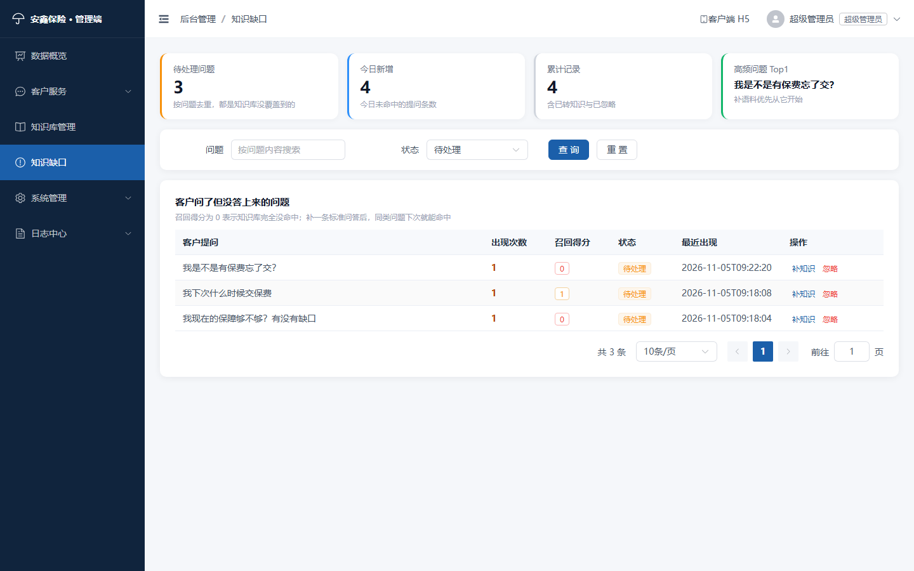
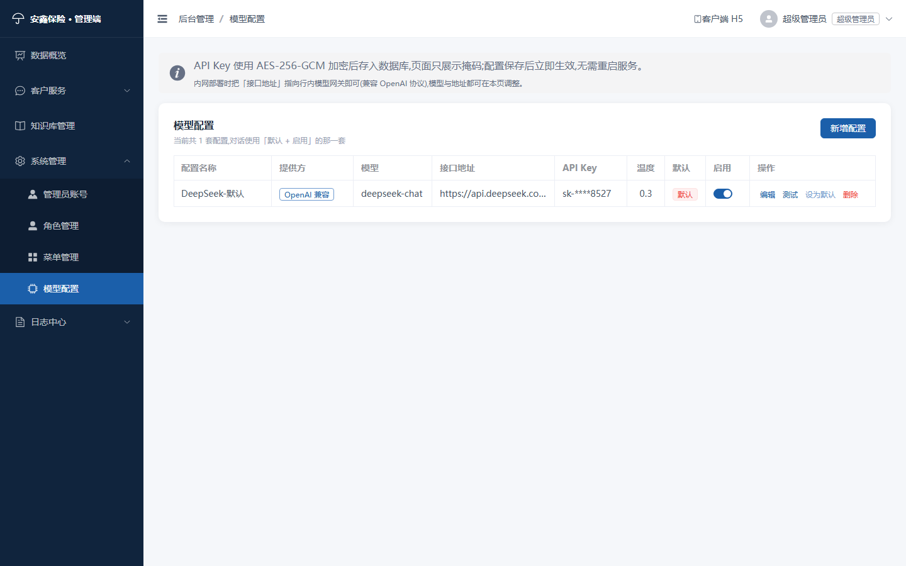
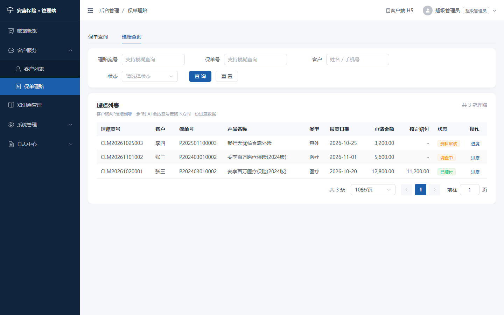

# 安鑫保险 · 智能客服系统

面向保险客户的自助智能客服平台，覆盖 **投保 / 保全 / 退保 / 减保 / 理赔** 五大业务场景，由大模型结合本地保险知识库回答问题，并提供独立的运营后台。

**核心特点**：双端双体系 · AI 能调工具查真实业务库（保单/理赔）· 模型与 API Key 后台可配且加密落库 · 工具调用强制按登录态过滤防越权。

## 界面预览

| 客户端（手机 H5） | 管理端 · 数据概览 |
| :---: | :---: |
|  |  |

| 管理端 · 服务工单（坐席工作台） | 管理端 · 知识缺口（知识库自我增长） |
| :---: | :---: |
|  |  |

| 管理端 · 模型配置（Key 加密存储） | 管理端 · 保单理赔 |
| :---: | :---: |
|  |  |

## 目录

- [一、环境要求](#一环境要求) ｜ [二、目录结构](#二目录结构) ｜ [三、快速启动](#三快速启动)
- [四、内置账号](#四内置账号) ｜ [五、功能说明](#五功能说明) ｜ [六、AI 能力](#六ai-能力spring-ai-alibaba--模型可配--工具自查)
- [七、流式对话与接口防护](#七流式对话与接口防护) ｜ [八、日志体系](#八日志体系可追踪--按天压缩归档) ｜ [九、已验证的联调结果](#九已验证的联调结果)
- [十、Docker 与 Nginx 部署](#十docker-与-nginx-部署) ｜ [十一、常见问题](#十一常见问题) ｜ [十二、安全提示](#十二安全提示)

系统采用 **双入口 + 双用户体系** 架构：

| | 客户端（咨询客户） | 管理端（业务操作人员） |
| --- | --- | --- |
| 入口 | `mobile.html`（手机 H5） | `index.html`（PC 后台） |
| 用户表 | `cus_user` | `sys_user` |
| 登录接口 | `/api/auth/**` | `/api/admin/auth/**` |
| 本地存储 Key | `insurance_ai_cus_token` | `insurance_ai_admin_token` |
| 权限 | 仅访问自己的会话与消息 | 由角色 → 菜单授权决定 |

两套体系 **数据隔离、接口隔离、登录页隔离、Token 隔离**，可在同一浏览器同时登录互不影响。

技术栈：**Vue 3 + TypeScript(strict) + Vite + Element Plus + Pinia** ｜ **Spring Boot 3.4.8 + Java 17 + MyBatis-Plus 3.5.9 + MySQL 8 + Redis + Spring Security + 国密（SM2/SM3/SM4）JWT + Spring AI 1.0.1 / Spring AI Alibaba 1.0.0.4 + springdoc-openapi 2.8.17**。

> AI 层不写死厂商：模型名称、接口地址、API Key、温度都从数据库读取，后台页面即可切换 DeepSeek / 通义千问 / 内网 vLLM / Ollama / 行内模型网关，改完立即生效、无需重启。详见「六、AI 能力」。

> **仓库内不含任何真实密钥**，所有敏感项均为环境变量占位，见「三、2 配置」。

---

## 一、环境要求

| 组件 | 版本要求 | 本项目已验证版本 |
| --- | --- | --- |
| JDK | 17 及以上 | 17.0.18 (Dragonwell) |
| Maven | 3.8+ | 3.9.12 |
| MySQL | 8.0+ | 8.0 |
| Redis | 5.0+ | 7.x |
| Node.js | 18+ | 22.22.2 |
| npm | 9+ | 10.9.7 |

> 本机若默认 `JAVA_HOME` 指向 JDK 8，需先切换：

```bash
export JAVA_HOME="D:/java/jdk17/Alibaba_Dragonwell_Standard_17.0.18.0.19.8_x64_windows/dragonwell-17.0.18.0.19+8-GA"
export PATH="$JAVA_HOME/bin:$PATH"
```

---

## 二、目录结构

```
insurance-ai-service/
├── docker-compose.yml                 # 一键启动:mysql + redis + backend + web
├── .env.example                       # 环境变量模板(复制为 .env 后填写)
├── deploy/nginx.conf                  # 站点配置(含 SSE 关闭缓冲、SPA 回退、安全头)
├── scripts/ci.sh                      # 本地一键校验(编译 / 测试 / 构建 / 密钥扫描)
├── .github/workflows/ci.yml           # CI:后端测试、前端构建、密钥泄漏检查
├── sql/
│   ├── insurance_ai.sql               # 建库建表 + 初始数据(可重复执行)
│   └── v2_ai_model_policy_claim.sql   # 增量:AI 模型配置 + 保单/理赔(幂等,可重复执行)
├── docs/API.md                        # 接口清单
├── backend/                           # 后端(8080,上下文 /api)
│   ├── Dockerfile                     # 多阶段构建 + 非 root 运行
│   └── src/
│       ├── main/java/com/insure/ai/
│       │   ├── common/
│       │   │   ├── Result / ResultCode / PageResult / BusinessException
│       │   │   ├── GlobalExceptionHandler / BaseEntity / PageQuery / Constants
│       │   │   ├── annotation/RateLimit.java      # 接口限流注解
│       │   │   ├── filter/TraceIdFilter.java      # 链路追踪 traceId
│       │   │   ├── serializer/                    # 证件号 / 手机号脱敏序列化器
│       │   │   ├── crypto/                        # 国密:Sm2Utils / Sm3Utils / Sm4Cipher
│       │   │   │                                  # + SensitiveDataCipher(统一敏感字段加解密)
│       │   │   ├── util/DesensitizeUtil.java      # 展示层脱敏
│       │   │   └── enums/                          # UserType / MenuType / ChatRole / AiProvider / Policy...
│       │   ├── config/                             # Security / MyBatis-Plus / Redis / Async / AdminInitializer
│       │   │                                       # + CryptoConfig(主密钥) / AiModelInitializer / OpenApiConfig
│       │   ├── security/                           # JwtUtils / JwtAuthenticationFilter / LoginAttemptService
│       │   ├── aspect/                             # 操作日志、危险参数拦截、限流切面
│       │   └── modules/                            # 统一分层:controller → service(接口) → service/impl
│       │       ├── system/
│       │       │   ├── service/AdminAuthService    # 管理端登录(校验角色状态)
│       │       │   ├── service/CusAuthService      # 客户端登录/注册
│       │       │   ├── service/MenuService         # 菜单树 + 按角色过滤
│       │       │   ├── service/RoleService         # 角色 + 菜单授权
│       │       │   ├── service/SysUserService      # 管理员账号
│       │       │   └── service/CusUserService      # 客户账号
│       │       ├── ai/
│       │       │   ├── entity/AiModelConfig        # 模型配置(api_key 存密文 + 掩码)
│       │       │   ├── service/AiModelConfigService# 增删改查 / 连通性测试 / 设默认
│       │       │   ├── service/AiModelFactory      # 按库中配置构建 ChatModel(动态 baseUrl+key)
│       │       │   └── tool/InsuranceQueryTools    # @Tool 查自己名下保单/理赔(强制登录态过滤)
│       │       ├── policy/                         # 保单 InsPolicy / 理赔 InsClaim / 进度 InsClaimProgress
│       │       ├── chat/                           # 会话、消息、同步 + SSE 流式对话
│       │       ├── kb/                             # 保险知识库 + 知识盲区
│       │       └── service/                        # 人工工单 + 回答评价
│       ├── main/resources/
│       │   ├── mapper/                             # 手工 SQL 全部在此,按模块分子目录
│       │   │   ├── chat/ kb/ policy/ service/ system/
│       │   ├── application.yml
│       │   └── logback-spring.xml                  # 按天滚动 + gz 压缩 + 异步 + traceId
│       └── test/java/com/insure/ai/                # 38 个单元测试(国密/脱敏/JWT/越权/序列化)
└── frontend/
    ├── Dockerfile                     # 构建 + Nginx 运行
    ├── index.html                     # 管理端入口
    ├── mobile.html                    # 客户端手机端入口
    ├── vite.config.ts                 # 多入口 + 代理 + SCSS 注入
    └── src/
        ├── api/modules/               # adminAuth / cusAuth / cusChat / menu / role / customer / kb / log / aiModel / policy
        ├── layouts/                   # AdminLayout.vue + MenuTree.vue(递归菜单)
        ├── mobile/                    # ★ 客户端手机端(独立 router/stores/views/styles)
        │   ├── router/                # hash 路由:/login /chat /history /profile
        │   ├── stores/cusUser.ts
        │   └── views/                 # LoginView / ChatView(SSE 流式) / HistoryView / ProfileView
        ├── router/index.ts            # 管理端路由 + 菜单动态注册守卫
        ├── stores/                    # adminUser + adminMenu(菜单驱动路由)
        ├── utils/                     # request(axios 工厂) / cusRequest / auth(双 key)
        │                              # + sse(POST + ReadableStream) / errorHandler(全局兜底)
        └── views/
            ├── login/                 # 管理端登录
            ├── admin/(dashboard|customer|user|menu|role|kb|log|model|policy)
            └── error/404.vue
```

### 代码分层与 SQL 约定

| 约定 | 落地方式 |
| --- | --- |
| 三层调用 | `controller` → `service`（接口）→ `service/impl`（实现），控制器只依赖接口，`@Transactional` 只写在实现类上 |
| 手工 SQL | 一律写在 `src/main/resources/mapper/<模块>/*.xml`，Mapper 接口只留方法声明，便于 DBA 审阅与索引优化 |
| 加解密 | 敏感字段（API Key 等）统一走 `SensitiveDataCipher`，算法为国密 SM4-GCM；账号密码则用框架自带 BCrypt，不重复造轮子 |
| 参数绑定 | XML 中使用的多参数方法必须标注 `@Param`，避免编译期丢参数名导致运行期 `BindingException` |

---

## 三、快速启动

### 1. 初始化数据库

```bash
mysql -uroot -p --default-character-set=utf8mb4 < sql/insurance_ai.sql
# 增量升级(AI 模型配置 + 保单理赔),已有库只需执行这一个
mysql -uroot -p --default-character-set=utf8mb4 insurance_ai < sql/v2_ai_model_policy_claim.sql
# 增量升级(回答评价 + 服务工单 + 知识盲区),已有库再执行这一个
mysql -uroot -p --default-character-set=utf8mb4 insurance_ai < sql/v3_service_closure.sql
```

主脚本创建数据库 `insurance_ai`（utf8mb4）与 **11 张表**，`v2` 增量脚本补 **4 张**，`v3` 再补 **3 张**，合计 18 张：

| 表名 | 说明 |
| --- | --- |
| `sys_user` | 管理端用户（业务操作人员） |
| `sys_role` | 角色（SUPER_ADMIN / OPERATOR …） |
| `sys_menu` | 菜单（DIR 目录 / MENU 菜单 / BUTTON 按钮） |
| `sys_role_menu` | 角色-菜单授权关系 |
| `cus_user` | 客户端用户（咨询客户，手机号登录） |
| `sys_login_log` | 登录日志（含 `login_type`：ADMIN / CUSTOMER） |
| `sys_oper_log` | 操作日志 |
| `sys_file` | 上传文件 |
| `kb_question` | 保险知识库语料 |
| `chat_session` | 会话（关联 `cus_user_id`） |
| `chat_message` | 消息（关联 `cus_user_id`） |
| `ai_model_config` | **大模型配置**（`api_key` 存国密 SM4-GCM 密文，`api_key_mask` 存展示掩码） |
| `ins_policy` | **保单**（客户、险种、保额、保费、保障期间、状态） |
| `ins_claim` | **理赔案件**（关联保单、申请/核定金额、状态、当前环节） |
| `ins_claim_progress` | **理赔进度节点**（时间轴，供 AI 回答“理赔到哪一步”） |
| `chat_feedback` | **回答评价**（有用/没用 + 差评原因，统计好评率） |
| `service_ticket` | **人工工单**（客户转人工、坐席接单/回复/结单） |
| `chat_unknown` | **知识盲区**（知识库未命中/低分命中的提问，供运营补语料） |

> 命名约定：`sys_` 前缀 = 管理端，`cus_` = 客户端，`kb_` = 知识库，`chat_` = 会话，`ai_` = 大模型，`ins_` = 保险业务。所有表含统一审计字段 `create_by / create_time / update_by / update_time / deleted / remark`。
>
> `v2` 脚本幂等（`CREATE TABLE IF NOT EXISTS` + 存在性判断后插入），重复执行不会报错也不会产生重复数据；同时会往 `sys_menu` 插入「模型配置」「保单理赔」两条菜单，执行后重新登录管理端即可看到。
>
> `v3` 脚本同样幂等：建 3 张表并插入「服务工单」（挂在客户服务下）与「知识缺口」（顶级菜单）两条菜单，同时会修复历史版本里被误改名的「保单理赔」菜单。

### 2. 配置（全部走环境变量，仓库里不含任何真实密钥）

`application.yml` 里所有敏感项都是 `${ENV:默认值}` 形式，**不要直接把密钥写进 yml**。

| 环境变量 | 必填 | 默认值 | 说明 |
| --- | --- | --- | --- |
| `MYSQL_HOST` / `MYSQL_PORT` | 否 | `127.0.0.1` / `3306` | 数据库地址 |
| `MYSQL_DATABASE` | 否 | `insurance_ai` | 库名 |
| `MYSQL_USERNAME` / `MYSQL_PASSWORD` | 否 | `root` / `root` | 数据库账号 |
| `INSURE_JWT_SECRET` | **生产必填** | 内置开发值 | JWT 签名密钥，≥ 32 字节 |
| `INSURE_CRYPTO_SECRET` | **生产必填** | 空（用内置兜底并告警） | API Key 加密主密钥，**配置后不可变更** |
| `INSURE_DEEPSEEK_API_KEY` | 否 | 空 | 仅用于首次启动迁移到 `ai_model_config`；留空则改为后台手动添加 |

Linux / macOS：

```bash
export INSURE_JWT_SECRET="$(openssl rand -base64 48)"
export INSURE_CRYPTO_SECRET="$(openssl rand -base64 48)"
export INSURE_DEEPSEEK_API_KEY="sk-你的key"
export MYSQL_PASSWORD="你的数据库密码"
```

Windows PowerShell：

```powershell
$env:INSURE_JWT_SECRET   = -join ((48..57)+(65..90)+(97..122) | Get-Random -Count 48 | % {[char]$_})
$env:INSURE_CRYPTO_SECRET = -join ((48..57)+(65..90)+(97..122) | Get-Random -Count 48 | % {[char]$_})
$env:INSURE_DEEPSEEK_API_KEY = "sk-你的key"
```

也可以写在 `backend/src/main/resources/application-local.yml`（已被 `.gitignore` 忽略，不会误提交），配合 `--spring.profiles.active=local` 使用：

```yaml
spring:
  datasource:
    password: 你的数据库密码
insure:
  jwt:
    secret: 至少32字节的随机串
  crypto:
    secret: 至少32字节的随机串
  deepseek:
    api-key: sk-你的key
```

> **模型的实际参数（模型名、接口地址、API Key、温度）以数据库 `ai_model_config` 为准**，`insure.deepseek.*` 只在 `ai_model_config` 为空时由 `AiModelInitializer` 用于初始化首条配置；`INSURE_DEEPSEEK_API_KEY` 留空时初始化器只打印一条提示后跳过，不影响启动。日常换模型/换 Key 请到后台「系统管理 → 模型配置」操作，不必改配置、不必重启。

### 3. 启动后端

```bash
cd backend
mvn clean package -DskipTests
mvn spring-boot:run
```

> 若环境存在 `SERVER__PORT` 变量会覆盖端口，可显式指定：
> `mvn spring-boot:run -Dspring-boot.run.arguments=--server.port=8080`

### 4. 启动前端

```bash
cd frontend
npm install
npm run dev          # 管理端 http://localhost:5173/
                     # 客户端 http://localhost:5173/mobile.html
```

Vite 代理：`/dev-api/**` → `http://127.0.0.1:8080/api/**`。

### 5. 打包与预览

```bash
npm run build:prod   # vue-tsc 类型检查 + 生产构建,产出 dist/index.html 与 dist/mobile.html
npm run preview      # 本地预览 http://localhost:4173
```

`vite preview` 已为 `/api` 配置代理，因此生产包也可直接本地预览。
生产部署时 `.env.production` 的 `VITE_API_BASE_URL=/api` 为同源相对路径，由 Nginx 反向代理到后端（见「九、Nginx 部署」）。

### 6. 接口文档（Swagger UI）

后端集成了 springdoc-openapi（`springdoc-openapi-starter-webmvc-ui 2.8.17`，对应 Spring Boot 3.4.x），启动后即可访问：

| 入口 | 地址 |
| --- | --- |
| Swagger UI（在线调试） | `http://localhost:8080/api/swagger-ui.html` |
| 管理端 OpenAPI JSON | `http://localhost:8080/api/v3/api-docs/admin-api` |
| 客户端 OpenAPI JSON | `http://localhost:8080/api/v3/api-docs/client-api` |

注意地址里带 `context-path` 的 `/api` 前缀，写 `http://localhost:8080/swagger-ui.html` 会 404。

**按双用户体系分成两个分组**，页面右上角「Select a definition」切换：

- `管理端接口`：`/admin/**`，47 个接口 / 10 个分组（登录认证、客户、管理员、角色、菜单、知识库、日志、概览、模型配置、保单理赔）
- `客户端(手机 H5)接口`：`/auth/**`、`/chat/**`、`/file/**`，16 个接口 / 3 个分组

**调试受保护接口**：

1. 展开「管理端-登录认证」→ `POST /admin/auth/login`，body `{"account":"admin","password":"123456"}`，执行后复制响应里的 `data.token`
2. 点右上角 **Authorize**，粘贴 token（**不需要**自己加 `Bearer ` 前缀，文档配置的是 HTTP bearer 方案）
3. 之后再执行任意接口，会自动带上 `Authorization` 请求头

登录、注册这两个免认证接口已在文档中标记为无锁，不需要先授权。切换分组后需重新 Authorize 一次（两套 token 不通用）。

相关配置：

- `config/OpenApiConfig.java` —— 文档标题/描述、JWT 认证方案、两个 `GroupedOpenApi` 分组
- `application.yml` 的 `springdoc.*` —— 文档开关、UI 路径、排序方式、默认分组
- `application.yml` 的 `insure.security.white-list` —— `/v3/api-docs/**`、`/swagger-ui/**`、`/swagger-ui.html` 已放行

**生产/内网交付时关闭文档**（避免暴露内部接口清单）：

```yaml
springdoc:
  api-docs:
    enabled: false
  swagger-ui:
    enabled: false
```

也可以用启动参数临时关闭：`java -jar insurance-ai-service.jar --springdoc.api-docs.enabled=false`。

---

## 四、内置账号

**管理端**（`http://localhost:4173/`）：

| 账号 | 密码 | 角色 | 菜单权限 |
| --- | --- | --- | --- |
| admin | 123456 | 超级管理员 SUPER_ADMIN | 全部菜单 + 系统管理 |
| operator | 123456 | 客服专员 OPERATOR | 数据概览 / 客户服务 / 知识库 / 日志（无系统管理） |

**客户端**（`http://localhost:4173/mobile.html`）：

| 手机号 | 密码 | 说明 |
| --- | --- | --- |
| 13900000001 | 123456 | 示例客户，也可在手机端「注册」自行创建 |

> 管理端登录页底部有「我是客户，进入手机端咨询」入口；客户端「我的」页底部有「我是员工，进入管理端」入口，两端互相跳转。

---

## 五、功能说明

### 客户端（手机 H5 · `mobile.html`）

- **手机模式**：`max-width: 480px` 居中，底部三 Tab（咨询 / 历史 / 我的），hash 路由，禁用缩放，适配 iPhone 安全区。
- **智能问答**：Spring AI Alibaba 驱动的大模型 + 知识库回答，气泡对话 + 打字动画 + 快捷提问。
- **问自己的保单与理赔**：直接问“我名下有哪些保单”“理赔到哪一步了”，AI 调用工具查真实业务库，按登录手机号自动限定范围，答不上来会明确说查不到而不是编造。
- **历史咨询**：会话列表、删除、点入回看完整上下文。
- **回答评价（有用 / 没用）**：每条 AI 回复下方可评价，选“没用”时给原因标签（信息有误 / 答非所问 / 不够完整 / 响应太慢 / 其他），同一消息重复评价做覆盖更新。这是“AI 答得好不好”的唯一真实信号，后台据此算好评率。
- **一键转人工**：底部「转人工客服」提交工单（带上本轮问题与业务分类），提交后可在「我的工单」看坐席接单与回复；同一个客户 10 分钟内最多提交 5 张，避免刷单占用坐席人力。
- **我的**：资料编辑、修改密码、我的工单、隐私说明、关于、退出登录。
- **登录 / 注册**：手机号登录，同一手机号仅可注册一次；注册需先获取 **短信验证码**（60 秒倒计时可重发、5 分钟有效），并勾选隐私说明。

### 管理端（PC · `index.html`）

- **数据概览**：累计会话 / 提问量 / 今日新增会话 / 知识库条数 / **AI 回答好评率** / **待处理工单** / 注册客户数 / 后台员工数 + 快捷入口。
- **客户服务 → 客户列表**：分页查询、详情、启停用、重置密码；「客户 360」抽屉按客户聚合 **在保单数 / 有效保额 / 理赔记录 / 咨询会话**，一屏看完客户名下保单、理赔与最近聊过什么——坐席接手工单时不用再切三个页面。
- **客户服务 → 服务工单**：坐席工作台。按工单号 / 状态 / 转人工原因 / 客户（姓名或手机号）/ 时间筛选；支持接单（自动记录处理人与接单时间）、回复并结单（客户手机端可见）、取消；顶部实时展示待处理、处理中、已完成、今日新增与人工接手率。
- **客户服务 → 保单理赔**：双页签「保单查询 / 理赔查询」，支持保单号、案号、客户模糊检索与险种/状态筛选；保单详情展示投保人、被保人、保额、缴费年限；理赔点「进度」看完整时间轴。**与 AI 读的是同一份数据**，客户在手机上问到的结果与后台所见一致。可用 `?tab=claim` 深链直达理赔页签。
- **知识库管理**：分类维护 FAQ，支持关键词、启停用，AI 回答优先引用命中条目。
- **知识缺口**：把“客户问了但知识库没答上来”的问题按相似问法聚合，按出现次数排序，显示最高召回得分与最近出现时间；可一键 **补知识**（自动生成待完善的知识条目草稿，补齐答案后即生效）或 **忽略**（闲聊类问题）。知识库从此能自己长大，而不是靠运营拍脑袋。
- **系统管理 → 管理员账号**：新增/编辑/启停用/重置密码，绑定角色；内置 `admin` 不可降级、禁用、删除。
- **系统管理 → 角色管理**：角色增删改 + `el-tree` 菜单授权（覆盖式保存）。
- **系统管理 → 菜单管理**：树表维护目录/菜单/按钮，配置路由地址、组件路径、图标、权限标识；**新增菜单后重新登录即可看到新菜单与新页面**。
- **系统管理 → 模型配置**：见「六、AI 能力」。
- **日志中心**：登录日志（区分管理端/客户端登录）、操作日志（参数脱敏、耗时、异常）。

### 短信验证码（注册闭环）

- 接口：`POST /auth/sms-code`，body `{ phone, scene }`，`scene` 取 `register` / `login` / `reset`。
- 频控：同一手机号同一场景 60 秒内不可重发（返回 `4003` 并告知还需等待多少秒），单日上限 10 条（`4004`）。
- 校验：验证码 5 分钟有效、一次性使用；单条验证码连续错 5 次即作废（`4007`），防止 6 位码被穷举。
- 存储：`sms:code:{scene}:{phone}` 等 key 全部落 Redis，多实例部署共享状态，不依赖本地内存。
- 注册：`insure.sms.verify-register=true`（默认）时注册必须带 `smsCode`，校验通过才落库；本地联调可临时置 false。
- **运营商尚未接入**：`SmsServiceImpl#doSend` 只打日志并视为发送成功，方法注释里给了阿里云 / 腾讯云两段对接示例。`insure.sms.mock=true` 时验证码随响应回显（`debugCode`），演示环境无需真实短信；接入后把 `mock` 置 false，`debugCode` 自然为空。

### 菜单驱动的动态路由

1. 登录后调用 `/api/admin/auth/menus` 拿到 **按当前角色过滤** 的菜单树；
2. `stores/menu.ts` 用 `import.meta.glob('/src/views/**/*.vue')` 把菜单的 `component` 字段（如 `admin/menu/index`）解析为组件；
3. `router.addRoute('AdminLayout', {...})` 动态挂载到布局下，侧边栏由同一份菜单树递归渲染；
4. 刷新页面时守卫会先加载菜单再重新解析当前地址，因此 **子路由可直接访问、可刷新**。

---

## 六、AI 能力（Spring AI Alibaba · 模型可配 · 工具自查）

### 1. 为什么用 Spring AI Alibaba

| 关注点 | 说明 |
| --- | --- |
| 统一抽象 | `ChatClient` 屏蔽厂商差异，换模型只换配置不改代码；本项目用 `spring-ai-alibaba-core` + `spring-ai-openai` |
| 工具调用（Function Calling） | `@Tool` 注解声明能力，由框架生成 JSON Schema 并解析模型返回，不必手写协议 |
| 内网落地 | 只要兼容 OpenAI 协议即可接入（vLLM / Ollama / 行内模型网关），`baseUrl` 可在后台改，符合保险公司内网私有化要求 |
| 版本约束 | Spring AI `1.0.1` + Spring AI Alibaba `1.0.0.4` 对应 Spring Boot 3.4.x；**不要混入 Spring AI 1.1.x 或 springdoc 3.x**（后者对应 Boot 4） |

依赖：

```xml
<dependency>
  <groupId>com.alibaba.cloud.ai</groupId>
  <artifactId>spring-ai-alibaba-core</artifactId>
  <version>1.0.0.4</version>
</dependency>
<dependency>
  <groupId>org.springframework.ai</groupId>
  <artifactId>spring-ai-openai</artifactId>
</dependency>
```

### 2. 模型与 API Key 配置（加密存库）

后台「系统管理 → 模型配置」可维护多条配置，字段：配置名称、提供方（`OpenAI 兼容` / `阿里百炼`）、模型名、接口地址、API Key、温度、是否默认、是否启用。

**密钥处理链路**：

1. 前端提交明文 Key → `AiModelConfigService` 调 `SensitiveDataCipher`（**国密 SM4-GCM**，密钥由 PBKDF2-HMAC-SM3 派生，随机 IV，密文带 `SM4:` 前缀）；
2. 库中 `api_key` 存密文，`api_key_mask` 存掩码（如 `sk-****cdef`），**列表接口只返回掩码，明文永不出库**；
3. 编辑时不改 Key 则沿用旧密文（前端传空即视为不修改）；
4. 主密钥来自 `insure.crypto.secret` / 环境变量 `INSURE_CRYPTO_SECRET`，未配置时退化为内置默认值并打印安全告警——**生产必须显式配置，且配置后不可变更**（变更后旧密文无法解密）；
5. 历史 AES 密文由 `CryptoMigrationRunner` 在启动时自动识别、解密并重新用 SM4 加密覆盖，存量数据无感迁移；无法解密的历史数据只告警不覆盖，需在后台重新录入。

**立即生效**：`AiModelFactory` 按「启用 + 默认」从库中取配置构建 `ChatModel`（`DashScopeChatModel` 或 `OpenAiChatModel`），带本地缓存，配置增删改时失效重建。**改完下一次提问即用新配置，无需重启服务**。

**连通性测试**：列表「测试」按钮 → `POST /admin/ai/model/test`，用该条配置真实发一次短对话，返回耗时与模型回复，用于上线前验证 Key 与网关是否可达。

### 3. 让 AI 自己查保单 / 查理赔 / 做服务

`modules/ai/tool/InsuranceQueryTools` 用 `@Tool` 暴露七个能力：

| 工具方法 | 作用 |
| --- | --- |
| `listMyPolicies()` | 查当前客户名下全部保单（险种、保额、保费、状态、保障期间） |
| `getPolicyDetail(policyNo)` | 按保单号查单张保单详情（投保人/被保人/缴费年限/下次缴费日/历史理赔次数） |
| `listMyClaims(policyNo)` | 查理赔记录（案号、类型、申请/核定金额、当前状态） |
| `getClaimProgress(claimNo)` | 按理赔案号查完整进度时间轴 |
| `analyzeCoverageGap()` | **保障缺口分析**：按险种（医疗/重疾/意外/寿险）对比已有保额，指出缺口方向，不推荐具体产品 |
| `listUpcomingPayments(days)` | **待缴保费提醒**：先查已逾期未缴（含宽限期剩余天数，超 60 天提示保单可能中止需复效），再查未来区间 |
| `getClaimChecklist(claimType)` | **理赔材料清单**：按医疗/重疾/意外/身故给标准清单，模型不得自行增删材料 |

**越权防护是本模块的核心约束**：

> 工具方法 **不接受模型传入的客户标识**，而是从 `SecurityContext` 取登录态 `cusUserId` 强制过滤。模型即使被诱导传入“别人”的保单号，也只能查到属于当前登录客户的数据；查不到就返回“未查询到该保单”，不会泄露存在性。已实测：用他人保单号提问被正确拒绝。

**SystemPrompt 同步约束**：`SystemPromptBuilder` 明确要求模型 —— 涉及保单/理赔必须调工具、不得凭知识库编造；工具结果为空要如实告知；身份与额度类问题不得臆测。

对话入口仍是 `ChatService`：

```java
ChatClient.create(chatModel)
    .prompt()
    .system(systemPrompt)
    .user(question)
    .tools(insuranceQueryTools)   // 工具调用
    .call()
    .content();
```

**长会话不失忆**：上下文只带最近 N 条消息，聊到十几轮后更早的诉求会被丢掉。`ChatService.appendEarlierDigest()` 把窗口之外的客户提问抽成一句「更早的沟通要点」注入 System，不额外调模型、不增加 token 费用。

**答不上来要留痕**：`KbQuestionService.recallWithScore()` 除了返回命中的知识条目，还返回最高召回得分；`ChatService` 在「完全没命中」或「只有低分命中」时写一条 `chat_unknown`，后台「知识缺口」页据此按频次聚合，把客户真正在问、知识库却答不上的问题暴露出来。**走工具查到业务数据的提问不算盲区**（如"我名下有哪些保单"），否则后台会堆满根本不需要补语料的个人数据查询。

### 4. 已验证的 AI 场景

| 提问 | 结果 |
| --- | --- |
| 我名下有哪些保单？保额分别多少？ | ✅ 调用工具，返回库中 3 张保单的真实产品名、保额、状态 |
| 我的理赔到哪一步了？ | ✅ 返回真实理赔案号与进度节点（如「资料审核 → 调查中」） |
| 用别人的保单号 P202403010002 查一下 | ✅ 拒绝，返回未查询到（越权防护生效） |
| 我现在的保障够不够？有没有缺口 | ✅ 指出已有医疗/重疾，缺意外与寿险，结尾提示「仅供参考，不构成投保建议」 |
| 我是不是有保费忘了交？ | ✅ 报出 2 张已逾期保单、逾期天数，并提示已超 60 天宽限期需办理复效 |
| 我要理赔需要准备哪些材料？ | ✅ 先反问理赔类型，再按类型调 `getClaimChecklist` 给标准清单 |
| 后台改 Key / 改模型后立即提问 | ✅ 无需重启，新配置生效 |
| `ai_model_config.api_key` 落库形态 | ✅ 密文，页面仅显示 `sk-****cdef` |

---

## 七、流式对话与接口防护

### 1. 流式输出（SSE）

同步接口 `POST /chat/send` 必须等模型整段生成完才返回：简单问答 1~3 秒无感，
但理赔多轮追问、长答案经常 8~15 秒，用户只能对着静止的打字动画等待；并发一高，Tomcat 线程池很快被占满。

因此新增 `POST /chat/send/stream`（`text/event-stream`）：

| 事件 | 载荷 | 说明 |
| --- | --- | --- |
| `meta` | `{sessionId, references, category}` | 会话已创建、知识库命中项 |
| `delta` | `{t: "增量文本"}` | 可多次，前端逐段追加 |
| `done` | `{sessionId, messageId, model, createTime}` | 生成结束且已落库 |
| `error` | `{message}` | 失败原因，前端提示后可重试 |

几个实现要点：

- **正文用 JSON 包装**（`{"t":"..."}`）而不是裸文本：模型输出里的换行如果直接进 `data` 字段，会和 SSE 的"空行分帧"语义冲突。
- **校验与会话创建仍在请求线程同步完成**，失败时前端拿到的还是标准 JSON 错误码，不会出现"流开了但没有错误信息"。
- **打字动画只在首字前显示**，一旦有内容就切到正文；否则文字会被动画挡住，直到结束才一次性出现（第一版实现踩过这个坑）。
- **响应头带 `X-Accel-Buffering: no`**，即使 Nginx 漏配 `proxy_buffering off` 也能流式下发。
- **离开页面时前端主动 `abort()`**，避免后端继续生成、白烧 token。

实测（本机 DeepSeek，390 字回答）：

| 时刻 | 已渲染字数 |
| --- | --- |
| +0.9s | 33 |
| +1.9s | 281 |
| +2.9s | 343（完成） |

> 本地 `vite preview` 的代理会缓冲 SSE，用 `npm run dev` 或 Nginx 才看得到逐字效果。这是预览工具的限制，不是代码问题。

### 2. 接口限流

对话按 token 计费且耗时较长，不设上限时单个账号写个循环就能把额度烧穿，顺带占满线程池。

`@RateLimit(limit, seconds, key)` + `RateLimitAspect`，Redis 固定窗口计数：

```java
@RateLimit(limit = 10, seconds = 60, key = "chat", message = "提问太频繁了，请稍后再试")
@PostMapping("/send")
public Result<ChatAnswerVO> send(...)
```

- 粒度是「登录用户 + 业务 key」，未登录降级为 IP；同步与流式两个入口共用 `key="chat"`，切换入口绕不过限制。
- **Redis 异常时降级放行**：限流是保护措施，不该变成新的故障点。
- 超限返回业务码 `429`，并给出还需等待的秒数。
- 后台「测试模型连通性」同样受限（5 次/分钟），它会真实发起一次计费调用。

实测：同一账号连续请求，第 1~10 次正常，第 11 次起返回 `429`。

### 3. 敏感字段出口脱敏

库里存的是明文证件号与手机号，**脱敏必须由输出环节保证**。
演示数据写成 `3301**********1234` 看着安全，但那只是录入时人工打的码——
真正对接业务库后，全量证件号会原样下发到浏览器。

现在改为在实体字段上声明序列化器：

```java
@JsonSerialize(using = IdCardSerializer.class)
private String insuredIdCard;

@JsonSerialize(using = PhoneSerializer.class)
private String customerPhone;
```

列表、详情、AI 工具返回统一生效，不依赖调用方自觉。
实测：把库中该字段改成完整号 `330102199001011234`，接口返回仍是 `3301**********1234`；手机号 `13900000001` 返回 `139****0001`。

### 4. 消息分页

`GET /chat/sessions/{id}/messages` 改为分页返回（默认 50 条/页，上限 200），
从最新往回翻、`records` 内部翻回正序，前端可直接渲染。会话攒到几百条时不再一次性全量下发。

---

## 八、日志体系（可追踪 · 按天压缩归档）

配置文件：`backend/src/main/resources/logback-spring.xml`

| 能力 | 实现 |
| --- | --- |
| 按天 + 按大小滚动 | `SizeAndTimeBasedRollingPolicy`，单文件 50MB，超出编号递增 |
| 自动 gzip 压缩 | `fileNamePattern = ${LOG_PATH}/%d{yyyy-MM-dd}/app.%d{yyyy-MM-dd}.%i.log.gz` |
| 保留策略 | `maxHistory=30`（天）、`totalSizeCap=5GB` |
| 错误单独归档 | 独立 `error.*.log.gz`，仅记录 `ERROR` 级别 |
| 异步写入 | `AsyncAppender`（队列 1024，`neverBlock=false`，`discardingThreshold=0`），不阻塞业务线程 |
| 链路追踪 | `TraceIdFilter`（最高优先级）为每次请求生成 `traceId`，写入 MDC 与响应头 `X-Trace-Id`；日志格式 `[%X{traceId}]` |
| 跨线程传递 | `AsyncConfig` 的 `MdcTaskDecorator` 在 `@Async` 线程池间复制/恢复 MDC |
| SQL 日志 | MyBatis-Plus `log-impl: org.apache.ibatis.logging.slf4j.Slf4jImpl`，统一进 SLF4J |

产物形态：

```
backend/logs/
├── app.log                      # 当天正在写入
├── error.log
├── 2026-11-04/
│   ├── app.2026-11-04.0.log.gz  # 前一天归档，已压缩
│   └── error.2026-11-04.0.log.gz
└── 2026-11-03/
    └── app.2026-11-03.0.log.gz
```

排查方式：从响应头取 `X-Trace-Id`，在各天归档中 `zgrep <traceId> */*.gz` 即可串起整条链路。

---

## 九、已验证的联调结果

以下均在本机实际运行验证（MySQL 8 + Redis + DeepSeek 真实调用）：

| 场景 | 结果 |
| --- | --- |
| 管理端登录（admin / operator） | ✅ 返回 token、角色与菜单权限 |
| 客户端手机号登录 / 注册唯一性 | ✅ 重复手机号被拒 |
| 双体系隔离 | ✅ 客户 token 访问 `/api/admin/user/page` 返回 `403 没有操作权限` |
| 菜单按角色过滤 | ✅ operator 无「系统管理」；admin 返回全部 5 个顶级菜单 |
| 菜单 CRUD | ✅ 新增/编辑成功；删除父级返回 `5002 请先删除子菜单` |
| 角色 CRUD + 菜单授权 | ✅ 授权后菜单树即时变化 |
| 客户端列表 / 详情 / 启停用 / 重置密码 | ✅ 会话数统计正确 |
| 子路由直接访问与刷新 | ✅ `/system/menu`、`/service/customer` 均正常渲染，不再 404 |
| 日志落盘与 traceId | ✅ `logs/app.log`、`logs/error.log` 正常写入，格式含 `[traceId]`，访问日志带状态码与耗时 |
| 日志按天压缩归档 | ✅ 滚动策略已配置（跨天或超 50MB 触发，写入 `logs/yyyy-MM-dd/*.log.gz`），保留 30 天、总量 5GB |
| TraceId 透传 | ✅ 请求头 `X-Trace-Id: xxx` 原样回显并在日志中可检索 |
| 已登录访问 `/login` | ✅ 自动跳转到有权限的第一个菜单（`/dashboard`） |
| 带 query 的子路由直开（`/service/policy?tab=claim`） | ✅ 正确落在理赔页签（守卫重解析时会保留 `query` / `hash`） |
| AI 工具调用（查保单 / 查理赔） | ✅ 返回库中真实数据，与后台列表一致 |
| AI 越权防护 | ✅ 用他人保单号提问被拒绝，不泄露存在性 |
| 模型配置加密 | ✅ `ai_model_config.api_key` 为 `SM4:` 前缀密文，接口仅返回 `sk-****8527`；启动时自动把历史 AES 密文迁移为 SM4 |
| 短信验证码 | ✅ 发送返回 6 位验证码；60 秒内重发返回 `4003`；错误验证码注册返回 `4006`；正确验证码注册成功 |
| 国密 JWT | ✅ 登录 token 头为 `{"alg":"SM2-SM3"}`，签名 SM2、摘要 SM3；历史 HS256 token 仍可校验通过 |
| 模型配置热生效 | ✅ 后台改 Key / 模型后下一次提问即生效，未重启 |
| Swagger 分组 | ✅ `admin-api` 47 个接口 / `client-api` 16 个接口；登录接口无锁 |
| 前端类型检查 / 构建 | ✅ `vue-tsc --noEmit` 零报错，`vite build` 产出 `index.html` + `mobile.html` |
| 双端页面渲染 | ✅ 手机端 390×844 无横向溢出；管理端各页面正常 |
| 后台表格布局 | ✅ 保单/理赔/模型页列宽实测填满容器（1116px），无固定列遮挡、无日期或金额折行 |
| 流式对话（SSE） | ✅ 390 字回答在 +0.9s 渲染 33 字、+1.9s 281 字、+2.9s 完成，事件为 meta + 155 个 delta + done |
| 流式模式下的工具调用 | ✅ 流式返回同样能调用保单查询，答复与后台数据一致 |
| 接口限流 | ✅ 同一账号第 1~10 次正常，第 11 次起返回 `429 提问太频繁了，请稍后再试` |
| 敏感字段脱敏 | ✅ 库中存 `330102199001011234`，接口返回 `3301**********1234`；手机号 `139****0001` |
| 消息分页 | ✅ `?pageNum=1&pageSize=4` 返回 `total` 与正序 `records` |
| 健康检查 | ✅ `/api/actuator/health` 匿名返回 `{"status":"UP"}`；`/actuator/metrics` 匿名访问被拦截 |
| 单元测试 | ✅ 38 个用例全绿（国密 SM2/SM3/SM4 / 脱敏 / JWT / 实体序列化 / 工具越权防护），JaCoCo 报告在 `backend/target/site/jacoco/` |

---

## 十、Docker 与 Nginx 部署

### 1. 一键启动（推荐）

```bash
cp .env.example .env        # 填 MYSQL_ROOT_PASSWORD / INSURE_JWT_SECRET / INSURE_CRYPTO_SECRET
docker compose up -d --build
```

| 服务 | 说明 | 是否对外 |
| --- | --- | --- |
| `web` | Nginx + 前端静态产物，`WEB_PORT`（默认 80） | ✅ 唯一暴露端口 |
| `backend` | Spring Boot，容器内 8080 | ❌ |
| `mysql` | MySQL 8，首次启动自动执行 `sql/*.sql` | ❌ |
| `redis` | Redis 7，AOF 持久化 | ❌ |

- 日志与上传文件挂到 `./data/logs`、`./data/upload`，容器重建不丢。
- `backend` 依赖 `mysql`/`redis` 的 healthcheck 通过后才启动；`web` 依赖 `backend` 健康。
- 后端镜像以非 root 用户运行，健康检查走 `/api/actuator/health`。
- 访问：管理端 `http://localhost`，手机端 `http://localhost/mobile.html`。

### 2. 手工部署（已有 Nginx / 需要接入行内网关）

```bash
# 后端
cd backend && mvn -DskipTests clean package
java -jar target/insurance-ai-service.jar

# 前端
cd frontend && npm ci && npm run build   # 产物在 dist/
```

Nginx 直接使用仓库内的 `deploy/nginx.conf`（已包含下面这些必须项），把 `backend:8080` 改成实际地址即可：

```nginx
# 关键：SSE 必须单独配置并关闭缓冲，否则流式会退化成"等十几秒一次性返回"
location = /api/chat/send/stream {
    proxy_pass http://127.0.0.1:8080/api/chat/send/stream;
    proxy_http_version 1.1;
    proxy_set_header Connection '';
    proxy_buffering off;
    proxy_cache off;
    proxy_read_timeout 300s;
    gzip off;
}

location /api/ {
    proxy_pass http://127.0.0.1:8080/api/;
    proxy_set_header Host $host;
    proxy_set_header X-Real-IP $remote_addr;
    proxy_set_header X-Forwarded-For $proxy_add_x_forwarded_for;
}

# 管理端是 history 路由，未命中的路径必须回落到 index.html，否则刷新子页面 404
location / {
    try_files $uri $uri/ /index.html;
}
```

> `deploy/nginx.conf` 另外处理了：静态资源长缓存、HTML 不缓存、`gzip` 不含 `text/event-stream`、
> 安全响应头（`X-Content-Type-Options` / `X-Frame-Options` / `Referrer-Policy`）、`/healthz` 探活。

手机端使用 hash 路由，`http://your-domain.com/mobile.html` 可直接打开，不依赖回退规则。

---

## 十一、常见问题

1. **编译报 `invalid target release: 17`**
   `JAVA_HOME` 仍指向 JDK 8，切换后 `mvn clean` 重试。

2. **启动报 `Unknown database 'insurance_ai'`**
   未执行 `sql/insurance_ai.sql`。

3. **启动报 Redis 连接失败**
   Redis 未启动或配置不符。

4. **AI 回答返回「智能客服暂时不可用」**
   按顺序排查：① 后台「模型配置」里是否有**启用且默认**的配置；② 点该行「测试」看 Key 与接口地址是否可达；③ 余额是否充足；④ 超时见 `insure.deepseek.timeout`。
   > 注意 Key 是加密存的，忘了明文只能在后台**重新录入**，无法从库里反查。

5. **后台改完模型配置，提问还是走旧模型**
   确认该条配置同时满足「启用」+「默认」；两者缺一不会生效。保存成功后 `AiModelFactory` 缓存立即失效，无需重启。

6. **AI 说查不到保单，但客户确实有**
   工具按**登录态手机号对应的 `cus_user_id`** 过滤，检查 `ins_policy.cus_user_id` 是否指向该客户；另外确认后台「保单理赔」页面能查到同一张保单（两边读同一份数据）。

7. **AI 被问“别人的保单”时应该怎么表现**
   设计为拒绝并返回未查询到。工具方法不接受模型传入的客户标识，这是刻意约束，不要为了“查得更全”而放开。

8. **管理端刷新子页面白屏 / 404**
   生产部署需配置 `try_files ... /index.html`；本项目已将兜底路由改为组件而非 `redirect`，避免守卫拿到被重定向后的地址。

9. **管理端登录后菜单为空**
   检查 `sys_role_menu` 是否有该角色授权；超级管理员（`SUPER_ADMIN`）返回全部启用菜单。

10. **手机端页面在 PC 上被拉窄**
    设计如此：`max-width: 480px` 居中模拟手机；用浏览器设备模拟器切到 iPhone 尺寸查看更准确。

11. **流式回答不是逐字出现，而是等一会儿一次性全出来**
    99% 是代理层缓冲。Nginx 需对该响应关闭 `proxy_buffering`（`deploy/nginx.conf` 已配，且后端也带了 `X-Accel-Buffering: no`）。
    本地用 `npm run preview` 也会出现，那是 vite preview 的代理缓冲，换 `npm run dev` 或直接用 Nginx 验证。

12. **提问弹「提问太频繁了」**
    对话接口限流 10 次/分钟（同步与流式共用计数），等一分钟后自动恢复。
    阈值在 `ChatController` 的 `@RateLimit` 上，按实际业务量调整；Redis 不可用时该限制会自动放行。

13. **后台看到的证件号是 `3301**********1234`**
    这是设计行为：`InsPolicy.insuredIdCard` 上挂了脱敏序列化器，出口一律打码，与库里存的是否明文无关。
    确实需要查看完整号码时，应另开受权限控制、带审计日志的专用接口，不要直接去掉注解。

---

## 十二、安全提示

- **仓库内不含任何真实密钥**：`application.yml` 里全部是 `${ENV:默认值}` 占位，真实值靠环境变量或 `application-local.yml`（已 gitignore）注入。
- **`INSURE_CRYPTO_SECRET` 是 API Key 加密主密钥**，未配置时会退化为内置默认值并打印告警，等于没加密。**配置后不可变更**，变更会导致库中已有密文无法解密，需逐条重录。
- **`INSURE_JWT_SECRET` 生产必须更换**，默认值仅供本地开发；长度 ≥ 32 字节。
- **国密算法落地**：数据传输与存储用国密套件——`SM4-GCM` 加密敏感字段（API Key）、`SM3` 做摘要与 `HMAC-SM3`、`SM2` 签名并签发 JWT（token 头 `alg=SM2-SM3`）。历史 HS256 token 在校验时自动兼容，过期即自然淘汰；账号密码仍用 Spring Security 自带 BCrypt，避免自研口令算法带来的风险。
- **敏感字段出口脱敏**：证件号、手机号由序列化器强制打码，不依赖录入数据时人工处理。
- **对话接口已限流**：按登录用户计数，Redis 异常时降级放行（限流是保护措施，不该成为新故障点）。
- **健康检查只放行 `/actuator/health`**：`metrics` 等端点仍需登录，不对外暴露 JVM 与连接池细节。
- 生产/内网交付时关闭 Swagger（见「三、6」），避免暴露内部接口清单。
- 生产环境建议下调 SQL 日志级别；`logging.level.com.insure.ai=info`。
- 日志目录 `backend/logs/` 已加入 `.gitignore`，不要提交归档文件。
- 上传目录 `./upload/` 建议挂载独立磁盘并配置定期清理。
- 内置账号密码（`123456`）仅用于演示，上线前必须修改。
- 演示数据（保单 P2024xxx、客户 13900000001、张三/李四）均为虚构，不含任何真实客户信息。
- 当前为**单租户**设计（内网私有化、单客户部署），未引入 `tenant_id`；若将来改为 SaaS 多客户，需在实体、Mapper、缓存键三处统一加租户隔离，越早改造成本越低。

---

## 十三、开源协议

本项目基于 [MIT License](LICENSE) 发布，可自由用于商业项目、修改与再分发，仅需保留版权与许可声明。

## 十四、免责声明

- 本项目为**技术演示与二次开发底座**，不构成任何保险销售、核保或理赔结论；接入生产前请完成合规评审、等保测评与业务系统对接。
- 大模型的回答存在不确定性。项目已通过「工具调用只查真实业务库 + 系统提示词约束 + 强制按登录态过滤」降低幻觉与越权风险，但**不能替代人工复核**，涉及赔付结论的场景务必保留人工确认环节。
- 演示数据（客户、保单、理赔）均为虚构，与任何真实机构、个人无关。

## 贡献

欢迎提 Issue / PR。提交前请跑一遍本地校验（等价于 CI）：

```bash
bash scripts/ci.sh
```

它依次检查：后端编译 → 38 个单元测试 → 前端类型检查 + 生产构建 → 硬编码密钥扫描。

另外请注意：

1. **不要提交任何真实密钥、客户数据或数据库备份**，敏感配置请走环境变量；
2. 新增敏感字段时，记得在实体上挂 `@JsonSerialize(using = ...Serializer.class)` 并补一条序列化断言；
3. 新增会调用大模型或按量计费的接口时，记得加 `@RateLimit`。
